<div align="center">

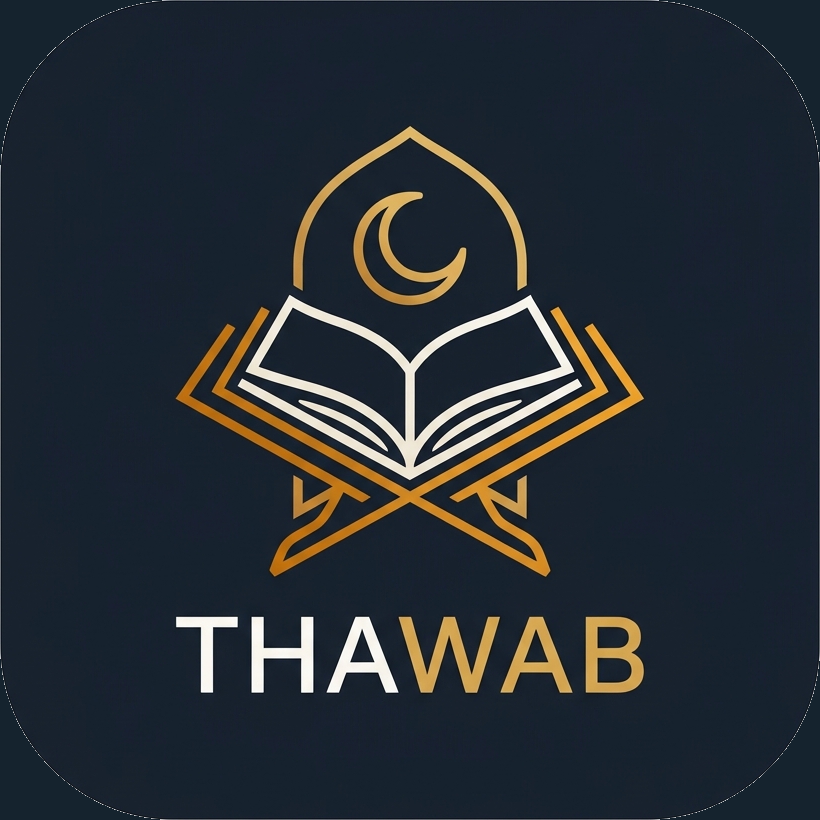

# ثواب · Thawab

**رفقة القرآن والأثر الطيب**
*A companion for the Quran and good deeds*

تطبيق Flutter عربي أولاً: مصحف، أذكار، مسبحة إلكترونية، ومواقيت الصلاة والقبلة.


</div>

---

## 📱 لقطات الشاشة · Screenshots

> التصاميم من **Google Stitch**، وهي موجودة في مجلد [`screens/`](screens/stitch_thawab_islamic_app_system). حالة التنفيذ لكل شاشة موضحة في [جدول الحالة](#-حالة-المشروع--status).

<table>
  <tr>
    <td align="center">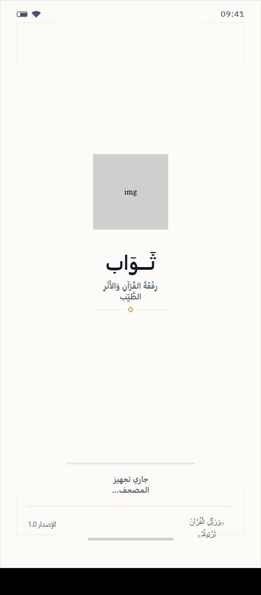<br/><sub><b>البداية</b><br/>Splash</sub></td>
    <td align="center">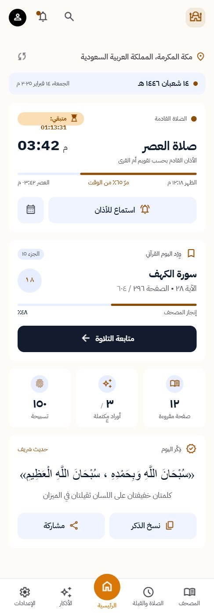<br/><sub><b>الرئيسية</b><br/>Home</sub></td>
    <td align="center">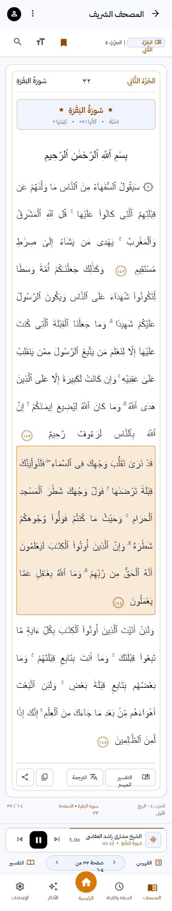<br/><sub><b>المصحف</b><br/>Quran reader</sub></td>
    <td align="center">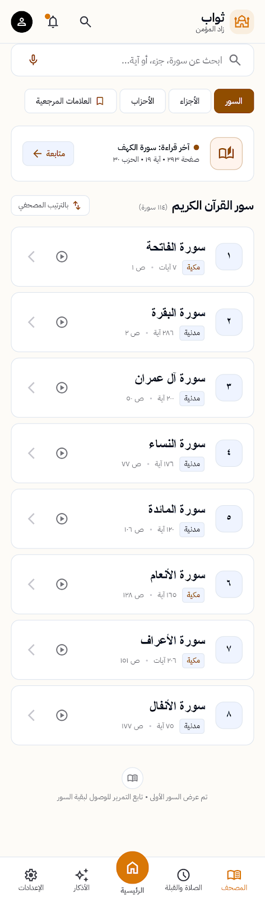<br/><sub><b>فهرس السور</b><br/>Surah index</sub></td>
  </tr>
  <tr>
    <td align="center">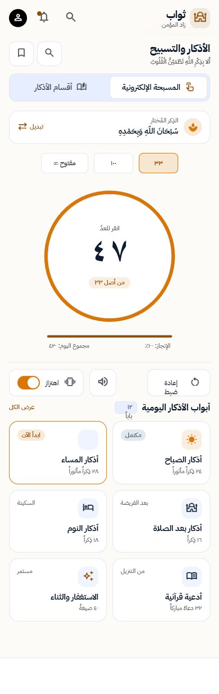<br/><sub><b>المسبحة</b><br/>Tasbeeh</sub></td>
    <td align="center">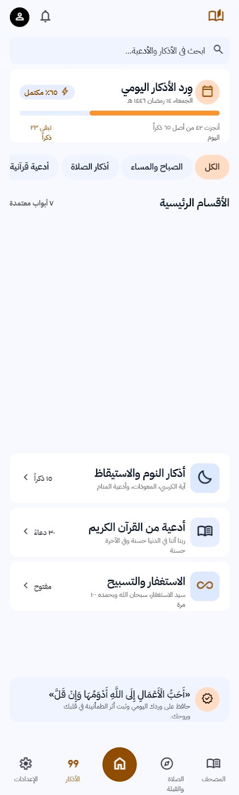<br/><sub><b>أقسام الأذكار</b><br/>Azkar categories</sub></td>
    <td align="center">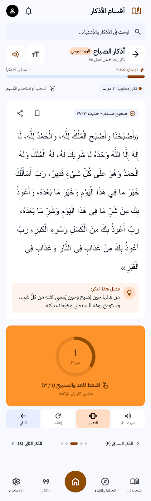<br/><sub><b>تفاصيل الذكر</b><br/>Dhikr detail</sub></td>
    <td align="center">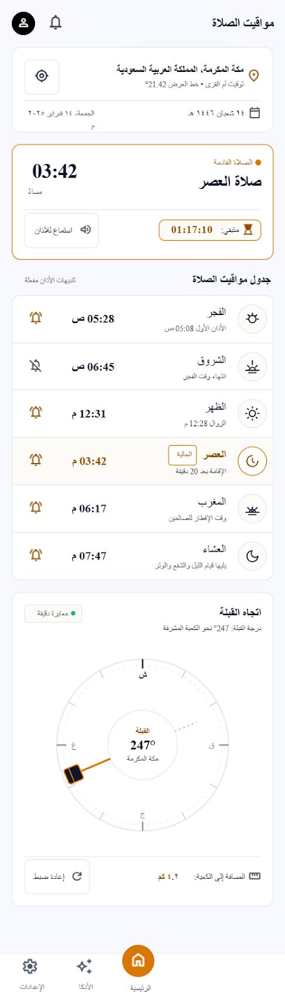<br/><sub><b>المواقيت</b><br/>Prayer times</sub></td>
  </tr>
  <tr>
    <td align="center">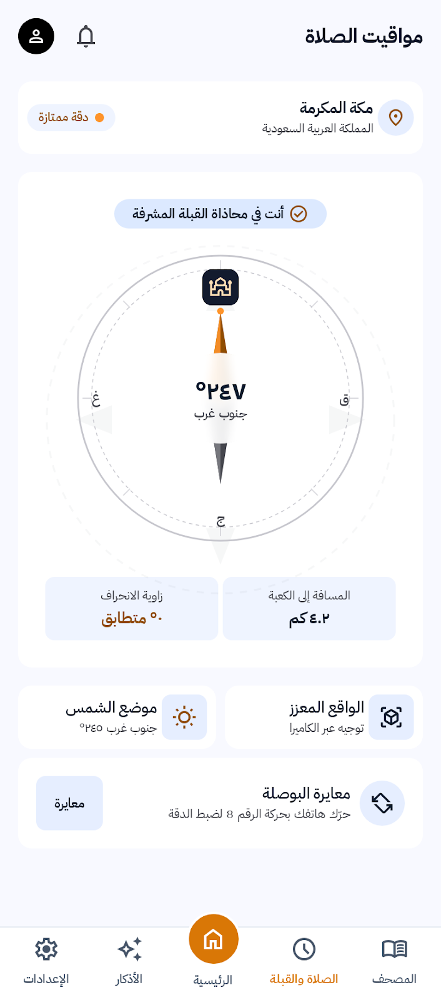<br/><sub><b>القبلة</b><br/>Qibla</sub></td>
    <td align="center">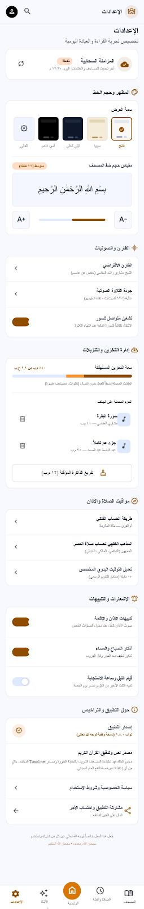<br/><sub><b>الإعدادات</b><br/>Settings</sub></td>
    <td></td>
    <td></td>
  </tr>
</table>

---

## ✨ المميزات · Features

- **المصحف الشريف**: قراءة بالنص العثماني صفحةً صفحة، وفهرس للسور (114 سورة) للتنقل السريع.
- **الأذكار**: أقسام الأذكار من *حصن المسلم* (الصباح والمساء، بعد الصلاة، النوم، أدعية قرآنية وغيرها) مع متابعة الورد اليومي.
- **المسبحة الإلكترونية**: عدّاد بنقرة واحدة مع أهداف جاهزة (33 / 100 / مفتوح).
- **لوحة رئيسية**: الصلاة القادمة، متابعة القراءة، وذكر اليوم.
- **ثنائي اللغة**: عربي (الافتراضي) وإنجليزي مع دعم الاتجاه RTL.
- **مظهر فاتح وداكن**.
- **يعمل دون إنترنت**: نص المصحف والأذكار مضمّنان داخل التطبيق.

## 🚦 حالة المشروع · Status

المشروع قيد التطوير. هذا ما هو منفّذ فعلياً في الكود حالياً:

| الميزة | الحالة |
|---|---|
| شاشة البداية (Splash) | ✅ |
| المصحف + فهرس السور (من بيانات Tanzil المحلية) | ✅ |
| الأذكار + المسبحة (من بيانات حصن المسلم المحلية) | ✅ |
| الإعدادات (اللغة والمظهر) | ✅ |
| الصفحة الرئيسية | 🟡 الهيكل جاهز، البيانات لم تُربط بعد |
| مواقيت الصلاة والأذان | 🟡 الواجهة جاهزة، مصدر البيانات لم يُربط بعد |
| بوصلة القبلة | 🔜 مخطط (تصميم فقط) |
| تشغيل التلاوات والتنزيلات والمزامنة السحابية | 🔜 مخطط (تصميم فقط) |

## 🧱 البنية · Architecture

يعتمد المشروع على **Clean Architecture** مقسّمة حسب الميزة (feature-first):

```
lib/
├── core/                 # theme, routing, errors, services, shared widgets
├── features/
│   └── <feature>/        # splash · home · quran · azkar · prayer · settings
│       ├── data/         #   data_sources · models · repositories (impl)
│       ├── domain/       #   entities · repositories (abstract)
│       └── presentation/ #   views · manager (cubits) · widgets
├── l10n/                 # app_ar.arb · app_en.arb
├── thawab_app.dart
└── main.dart
```

**التقنيات · Stack**

| الغرض | الحزمة |
|---|---|
| إدارة الحالة | `flutter_bloc` (Cubit) |
| التوجيه | `go_router` |
| حقن الاعتماديات | `get_it` |
| معالجة الأخطاء | `dartz` (`Either`) · `equatable` |
| الشبكة | `dio` · `internet_connection_checker_plus` |
| التخزين المحلي | `shared_preferences` |
| تجاوب الأبعاد | `flutter_screenutil` |
| الخط | IBM Plex Sans Arabic |

## 🚀 التشغيل · Getting Started

**المتطلبات:** Flutter SDK مع Dart `^3.13.3`.

```bash
git clone https://github.com/Ahmed-Elzaher/thawab.git
cd thawab

flutter pub get
flutter gen-l10n      # اختياري، يتم تلقائياً مع generate: true
flutter run
```

للتشغيل على منصة محددة: `flutter run -d chrome` أو `-d windows` أو `-d <device-id>`.

**الاختبارات**

```bash
flutter test
```

## 📚 المصادر والتراخيص · Data & Licenses

- **نص القرآن الكريم (الرسم العثماني)** من [Tanzil.net](https://tanzil.net) وفق ترخيصه، والتفاصيل في [`assets/tanzil-license.txt`](assets/tanzil-license.txt) و[`assets/tanzil-metadata-license.txt`](assets/tanzil-metadata-license.txt).
- **الأذكار** من بيانات *حصن المسلم*، والترخيص في [`assets/hisn-al-muslim-license.md`](assets/hisn-al-muslim-license.md).
- **الخط** IBM Plex Sans Arabic بترخيص OFL، في [`assets/fonts/OFL.txt`](assets/fonts/OFL.txt).

## 🤝 المساهمة · Contributing

الاقتراحات وطلبات الدمج مرحّب بها. افتح Issue أولاً لمناقشة أي تغيير كبير.

---

<div align="center">

<sub>اللهم تقبّل منا ومنكم صالح الأعمال · Made with Flutter</sub>

</div>
